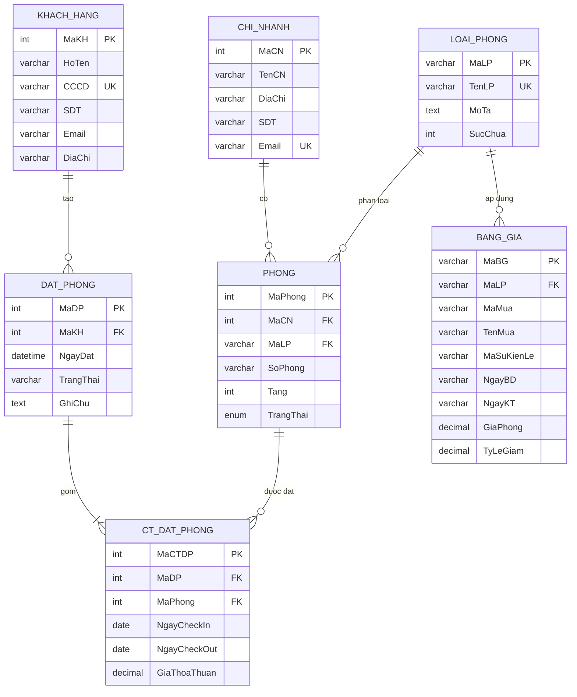
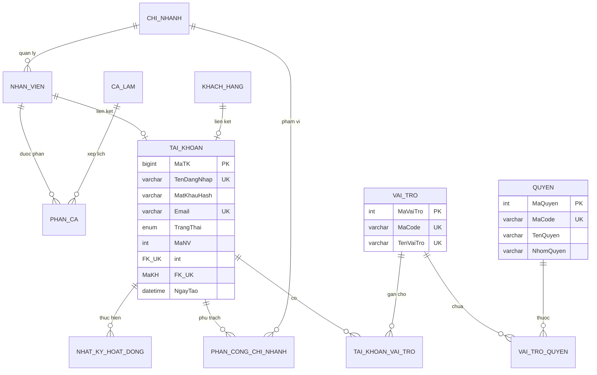

# Sơ đồ ERD và mô hình dữ liệu hệ thống quản lý chuỗi khách sạn

Tài liệu mô tả cấu trúc 28 bảng trong [01_schema.sql](../sql/01_schema.sql) theo 4 nhóm thực thể: **Khách sạn & Phòng**, **Đặt phòng & Dịch vụ**, **Tài chính, Combo & Vé**, và **Nhân sự & Phân quyền (RBAC)**.

---

## 1. Nhóm Chi nhánh, Phòng, Giá & Khách hàng



---

## 2. Nhóm Dịch vụ, Tài chính, Combo & Khu vui chơi

```mermaid
erDiagram
    CHI_NHANH ||--o{ DV_CHI_NHANH : "cung cap"
    DICH_VU ||--o{ DV_CHI_NHANH : "cau hinh tai"
    DV_CHI_NHANH ||--o{ SU_DUNG_DV : "phat sinh"
    DAT_PHONG ||--o{ SU_DUNG_DV : "su dung"

    DAT_PHONG ||--o| HOA_DON : "lap"
    HOA_DON ||--|{ CT_HOA_DON : "chi tiet"
    HOA_DON ||--o{ GIAO_DICH_THANH_TOAN : "thanh toan"

    CHI_NHANH ||--o{ GOI_COMBO : "co"
    LOAI_PHONG ||--o{ GOI_COMBO : "ap dung"

    CHI_NHANH ||--o{ KHU_VUI_CHOI : "so huu"
    KHU_VUI_CHOI ||--o{ LOAI_VE : "phat hanh"
    LOAI_VE ||--o{ VE_DIEN_TU : "thuoc loai"
    DAT_PHONG ||--o{ VE_DIEN_TU : "dinh kem"
    KHACH_HANG ||--o{ VE_DIEN_TU : "so huu"

    MA_GIAM_GIA {
        int MaVoucher PK
        varchar Code UK
        varchar LoaiGiam
        decimal GiaTriGiam
        decimal DonHangToiThieu
        decimal GiamToiDa
        int SoLuongPhatHanh
        int SoLuongDaDung
        date NgayBatDau
        date NgayKetThuc
        varchar TrangThai
    }
    HOA_DON {
        int MaHD PK
        int MaDP FK_UK
        datetime NgayLap
        decimal TongTien
        decimal TienCoc
        varchar TrangThai
    }
    CT_HOA_DON {
        int MaCTHD PK
        int MaHD FK
        varchar LoaiKhoanThu
        varchar MoTa
        decimal SoLuong
        decimal DonGia
    }
    GIAO_DICH_THANH_TOAN {
        int MaGiaoDich PK
        int MaHD FK
        varchar CongThanhToan
        varchar MaGiaoDichCong
        decimal SoTien
        datetime ThoiGianGD
        varchar TrangThai
        varchar NoiDungChuyenKhoan
    }
```

---

## 3. Nhóm Nhân sự & Phân quyền (RBAC theo chi nhánh)



---

## 4. Tóm tắt các cơ chế toàn vẹn dữ liệu đã cài đặt

| Lớp bảo vệ | Cơ chế trong SQL | Mục đích chính |
|---|---|---|
| Ràng buộc miền & khóa | `CHECK`, `ENUM`, `UNIQUE`, `FOREIGN KEY` ([01_schema.sql](../sql/01_schema.sql)) | Đảm bảo `NgayCheckOut > NgayCheckIn`, `SucChua > 0`, `GiaPhong > 0`, tài khoản chỉ gắn với `MaNV` hoặc `MaKH` (không cả hai) |
| Trigger tự động | `BEFORE/AFTER` triggers ([03_triggers.sql](../sql/03_triggers.sql)) | Chặn đặt trùng lịch đã xác nhận; tự đồng bộ `HOA_DON.TongTien` theo `CT_HOA_DON` |
| Transaction & Khóa dòng | `START TRANSACTION` + `FOR UPDATE` ([07_views_and_procedures.sql](../sql/07_views_and_procedures.sql)) | Tránh tranh chấp đặt cùng phòng (`sp_tao_dat_phong`), đồng bộ thanh toán (`sp_ghi_nhan_thanh_toan`) |
| Chỉ mục hiệu năng | 6 `INDEX` ([01_schema.sql](../sql/01_schema.sql)) | Tăng tốc tìm phòng theo khoảng ngày, tra hóa đơn, giao dịch, phân công chi nhánh |
| Kiểm toán dữ liệu | 8 nhóm truy vấn ([04_data_audit.sql](../sql/04_data_audit.sql)) | Rà soát lệch tổng tiền, trùng lịch, dịch vụ sai chi nhánh, vé quét thiếu giờ |
